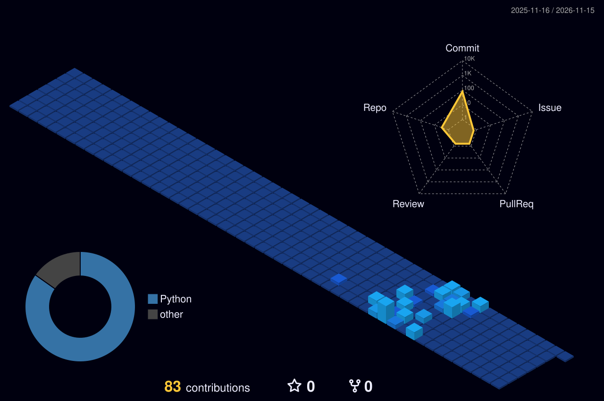

\

\

\</div\>

\

# 👋 Hi, I'm GIK

### 📊 Data Analyst \| 🐍 Python Developer

**Python • Pandas • NumPy • SQL • PostgreSQL • MySQL • Power BI**

*Turning Data into Business Insights.*

\</div\>

\<br\>

\<h2 align="center"\>👨‍💻 About Me\</h2\>

\

I'm a Data Analyst and Python Developer focused on transforming raw data
into meaningful insights and practical business solutions.

I use Python, SQL, and Power BI to help turn complex and unstructured
data into reliable analysis, clear reports, and useful visualizations.

My approach combines technical problem-solving with an understanding of
business needs --- from preparing data for analysis to communicating
findings that support better decisions.

\</div\>

\<br\>

\<h2 align="center"\>💼 Services\</h2\>

\

  -----------------------------------------------------------------------
  Service                             Description
  ----------------------------------- -----------------------------------
  **Python Data Analysis**            Exploring datasets, identifying
                                      patterns, and extracting actionable
                                      insights.

  **Data Cleaning & Preparation**     Handling missing values,
                                      duplicates, inconsistencies, and
                                      transforming raw data into
                                      analysis-ready datasets.

  **SQL Analysis & Reporting**        Querying relational databases,
                                      analyzing business data, and
                                      creating structured reports.

  **Power BI Dashboards**             Building interactive dashboards and
                                      visual reports to make business
                                      performance easier to understand.
  -----------------------------------------------------------------------

\</div\>

\<br\>

\<h2 align="center"\>🛠️ Tech Stack\</h2\>

\

\

\<br\>\<br\>

**Data Analysis:** Python • Pandas • NumPy • SQL

**Databases:** PostgreSQL • MySQL

**Business Intelligence:** Power BI

**Development Tools:** FastAPI • Git • GitHub

\</div\>

\<br\>

\<h2 align="center"\>🚀 Featured Projects\</h2\>

### 1. [DATA_PREPARATION_SYSTEM](https://github.com/gik-eng/DATA_PREPARATION_SYSTEM)

A Python-based data preparation system designed to organize and
streamline common data preparation tasks, including cleaning,
transformation, validation, and duplicate handling.

**Focus:** Python • Data Cleaning • Data Transformation • Data
Validation

### 2. [DATA_ANALYSIS_ROADMAP](https://github.com/gik-eng/DATA_ANALYSIS_ROADMAP)

A practical learning and project repository documenting my work across
core Data Analysis topics, including Python, Pandas, NumPy, SQL, and
Power BI.

**Focus:** Python • Pandas • NumPy • SQL • Power BI

### 3. Sales_Invoice --- Client Project

A desktop sales and invoice management application developed for a
client. The project addresses business workflows involving customer
records, invoices, item details, pricing calculations, and Excel
exports.

The backend was developed independently, with AI assistance used during
frontend development. Client-specific information and confidential data
are not included in this public profile.

**Focus:** Python • PostgreSQL • SQLAlchemy • Desktop Application
Development

\<br\>

\<h2 align="center"\>🎓 Education & Certifications\</h2\>

\

**Education:** Final-Year Computer Engineering Student

**Certification:** CS50's Introduction to Programming with Python
(CS50P)

**Additional Learning:** edX Courses and Certificates

\</div\>

\<br\>

\<h2 align="center"\>📊 My 3D Contributions\</h2\>

\

\

\</div\>

\<br\>

\<h2 align="center"\>🟡 Pac-Man Contributions\</h2\>

\

\

\</div\>

\<br\>

\<h2 align="center"\>📫 Contact\</h2\>

\

\<a href="mailto:binarycat8@gmail.com"\> \ \</a\>

\</div\>
